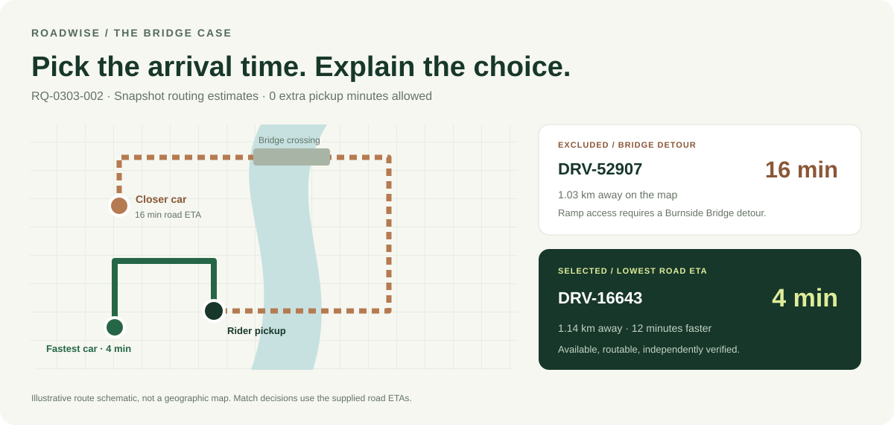
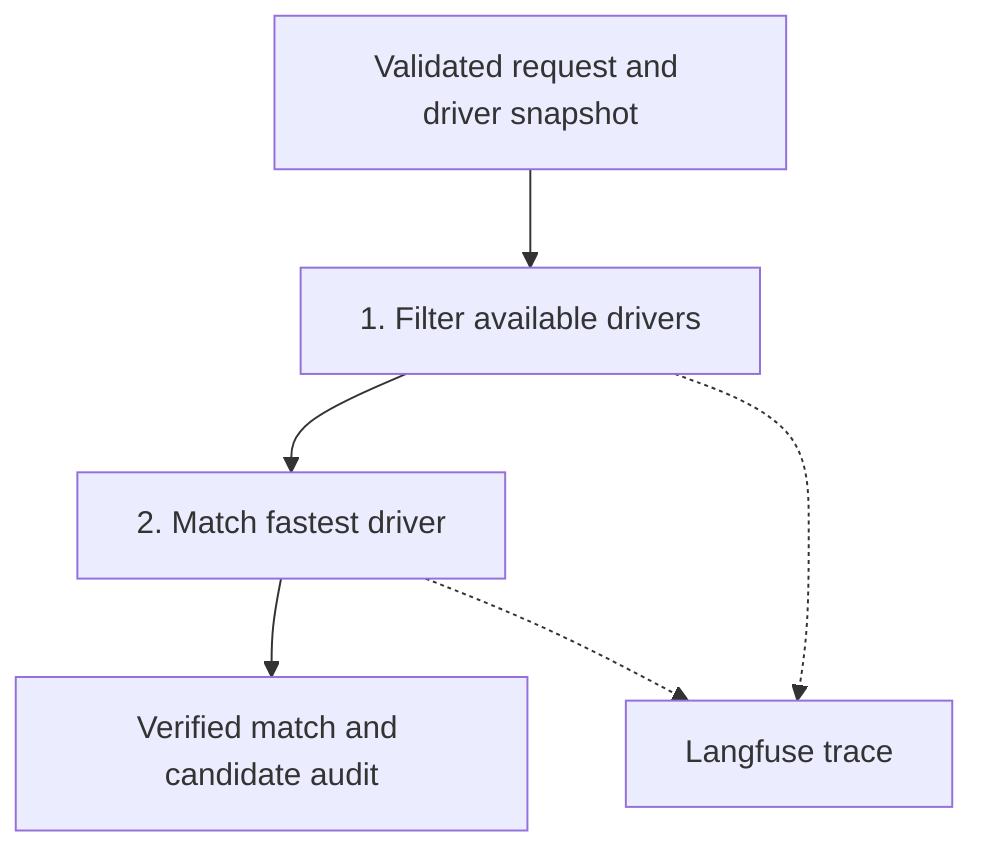

# Roadwise · AI Ride Matcher

[](https://github.com/bhavesh-210/ai-agent-ride-matcher/actions/workflows/tests.yml)

[](LICENSE)

**The closest-looking car can be 12 minutes slower.** Roadwise matches by supplied road pickup ETA, checks every model proposal in code, and records why each candidate won or lost.

Built with **Python, LangGraph, Pydantic v2, OpenRouter, FastAPI, pytest and Langfuse**. Includes a key-free interactive demo, offline trace replay and a REST API.



## What it proves

| Check | Result on the supplied snapshot |
|---|---|
| Evaluation scope | 20 requests, 80 candidate rows |
| Assignment outcome | 19 matches; 1 explicit no-match caused by a source-ID mismatch |
| Nearest available car baseline | 113 total supplied pickup minutes across the 19 matched rides |
| Minimum road ETA matcher | 60 total supplied pickup minutes; **46.9% lower aggregate ETA** |
| Requests improved over the baseline | 7 of 19 matched rides |
| Bridge case | 4-minute driver wins over the geographically closer 16-minute driver |
| Archived live tracing | 20 hosted traces, 19 real OpenRouter calls, 326 observations |

These are results on a small snapshot, **not measured real-world rider wait-time reductions**. Run `python -m ride_matcher.benchmark` to reproduce the comparison without API keys. The unmatched request stays unmatched; the matcher does not guess a corrected source ID.

## Open the demo

**[Launch the public demo →](https://roadwise-bhavesh-demo.scenicboat64.chatgpt.site/)** — no installation, sign-in or API keys. Explore recorded Python-agent outputs for all 20 requests, including the bridge case. The hosted page replays snapshot results; it does not execute a live model call. [Demo source](web-demo/README.md).

## Run the Python agent locally

Python 3.11 or 3.12. From a terminal:

```bash
git clone https://github.com/bhavesh-210/ai-agent-ride-matcher.git
cd ai-agent-ride-matcher
python3 -m venv .venv
source .venv/bin/activate
python -m pip install -r requirements-tested.txt
RIDE_MATCHER_DEMO_ONLY=1 python -m uvicorn ride_matcher.api:app --host 127.0.0.1 --port 8000
```

Open **http://127.0.0.1:8000**. The bridge case loads first. Select any of the 20 rides to inspect the driver status, map distance, road ETA and exclusion reason. `RQ-0308-018` demonstrates the source-ID no-match case.

The quickstart sets demo-only mode, disabling the live endpoint and hosted SDK even if you already have private keys configured. The `/demo/*` routes are explicitly offline: no model call, no API keys and no hosted trace upload. The demo executes the same matching graph as the live endpoint. [Walkthrough and API examples](docs/demo.md).

## How a decision works



1. **Filter:** check availability, obtain the supplied road ETA, and apply eligibility before sending any candidates to OpenRouter. Offline, on-trip and missing-route drivers are excluded.
2. **Match:** ask for a structured proposal, then independently verify the driver ID and ETA against the deterministic minimum. An invalid proposal or provider failure falls back to the fastest eligible driver, without a second model call. Equal ETAs use driver ID ascending.

The shared policy lives in [`config/matching.json`](config/matching.json): `accepted_extra_pickup_minutes` defaults to **0**. An environment override is supported. This value controls the model shortlist; the final guard still enforces the minimum ETA even when the shortlist is wider. State models are frozen and validated at graph boundaries.

**Why use an LLM?** It supplies a structured proposal and an explanation within an observable workflow. A plain `min()` is sufficient for ETA ranking, and remains the safety boundary here. The model does not calculate live routes or invent pickup times.

## The bridge case

For request `RQ-0303-002`:

| Driver | Map distance | Supplied road ETA | Decision |
|---|---:|---:|---|
| `DRV-52907` | 1.03 km | 16 min | Excluded at the default allowance; Morrison ramp access requires a Burnside Bridge detour |
| `DRV-16643` | 1.14 km | 4 min | Selected: lowest available road ETA |

Every original candidate receives an audit entry, including unavailable drivers removed before the model. The saved trace places route notes and exclusion reasons beside those times. [Actual live bridge trace](evidence/stage3-live/bridge-trace.json).

## Tests and offline replay

Verified locally and in GitHub Actions: **113 passing pytest cases on Python 3.11 and 3.12**. The recorded source revision and raw output are linked below.

```bash
python -m pytest -q
python -m ride_matcher.benchmark
python -m ride_matcher.replay evidence/stage3-live/traces.json
```

Tests cover the real and synthetic bridge traps, availability, ties, malformed model proposals, provider failures, invalid ETAs, configuration, concurrent API trace IDs and trace export validation. All 20 saved live traces are replayed as regression cases with no provider calls. Replay uses recorded status and ETA inputs; redacted GPS coordinates are replaced with placeholders because coordinates are not ranking inputs.

The trace auditor compares native generation model/token fields with root copies, validates finite latency, rejects falsely skipped calls, and independently checks the selected minimum ETA. GitHub Actions runs tests on Python 3.11 and 3.12. [Latest source-scoped verification](docs/verification.md).

## Live API and tracing

Copy `.env.example` to `.env`; keep keys private. Set `OPENROUTER_API_KEY` and a currently available `OPENROUTER_MODEL` ending in `:free`. Free model availability and quotas may change. Use `python -m ride_matcher --list-models` to inspect availability.

Start the server **without** `RIDE_MATCHER_DEMO_ONLY=1` to use the live endpoint. The API exposes:

| Route | Purpose |
|---|---|
| `GET /` | Interactive offline snapshot demo |
| `GET /health` | Service and tracing configuration status |
| `GET /docs` | Interactive OpenAPI documentation |
| `POST /match` | Live OpenRouter proposal with deterministic validation |
| `POST /demo/match/{request_id}` | Key-free matching demo for a supplied snapshot ride |

To enable hosted API tracing, set all three `LANGFUSE_PUBLIC_KEY`, `LANGFUSE_SECRET_KEY`, `LANGFUSE_BASE_URL` values and `SOURCE_COMMIT` to `git rev-parse HEAD`, then restart the server. One shared SDK client is initialized at startup and flushed/shut down on exit. Partial or invalid tracing configuration fails startup. Each valid `/match` invocation creates its own root trace; its ID is returned in the **`X-Trace-Id`** response header. Validation errors and missing provider credentials are rejected before the matching graph runs.

The root contains child node, tool, generation and guard observations. Trace payloads exclude rider identity and coordinates; model prompts, route notes, candidate IDs and explanations remain visible to the configured provider/trace destination. Graph, client-model and provider timing are kept separate. [Trace conventions](docs/langfuse-conventions.md).

To create a **new** traced batch:

```bash
python -m ride_matcher.trace_batch \
  --destination langfuse --provider-mode openrouter \
  --source-commit "$(git rev-parse HEAD)" \
  --output-dir runs/my-live-batch
```

Use `--destination local --provider-mode offline` for a local SDK export with no model call. New batches refuse to overwrite existing trace artifacts. Evaluation prints to the terminal by default; use `--output runs/evaluation.json --source-commit "$(git rev-parse HEAD)"` to save a new versioned record.

## Evidence and limitations

The original hosted live batch was executed from source commit [`98c5804`](https://github.com/bhavesh-210/ai-agent-ride-matcher/commit/98c5804d18e90484023abf0d79b7f3a16469c40c). It is historical evidence, not proof of another live run after the portfolio updates. [Live evidence and audits](evidence/stage3-live/README.md) · [Stage/commit index](evidence/evidence-index.json) · [Archived assignment and planning history](docs/submission-history.md).

The source request `RQ-0308-018` has no candidates; four rows refer to `RQ-0309-018`. Exact matching intentionally preserves this discrepancy. [Dataset provenance](data/README.md).

This is a tested snapshot prototype. It does not provide live traffic routing, atomic driver reservation, authentication, rate limits or fleet-scale performance guarantees. Run the demo on localhost; a public deployment would need those controls. The code is [MIT licensed](LICENSE); supplied third-party datasets retain their original terms.
