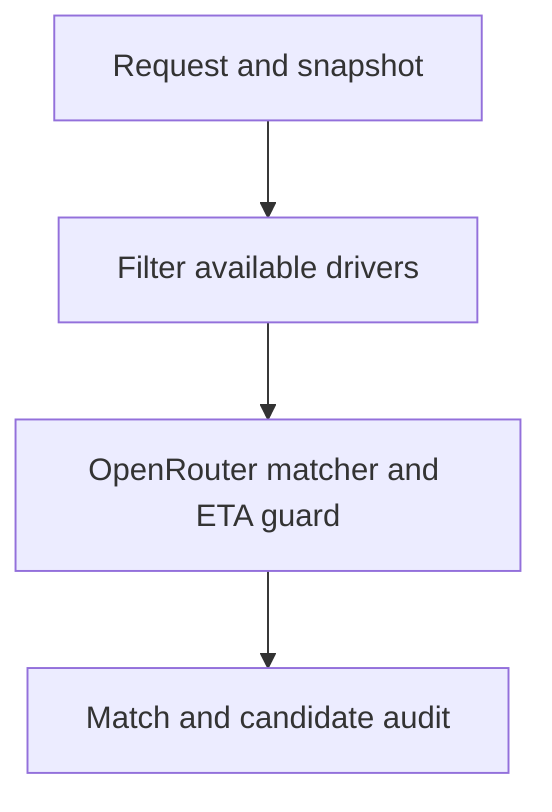
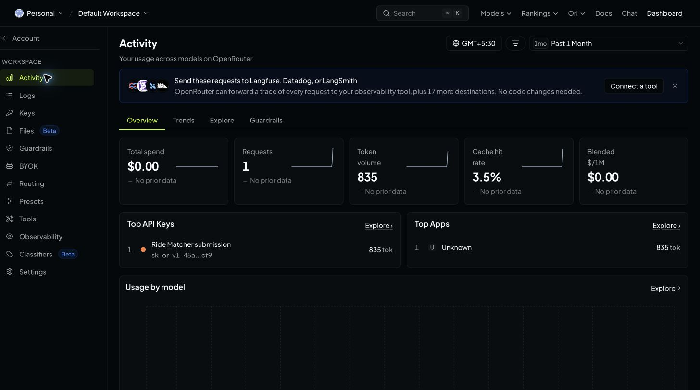

# AI Agent Ride Matcher — Stage 1

Exactly two LangGraph nodes: filter available drivers → OpenRouter matcher with deterministic road-ETA verification. Frozen Pydantic v2 models, per-candidate audit, JSON evidence, pytest, and optional FastAPI.

**Status:** 16 tests passed. Synthetic offline bridge demo passed. No live OpenRouter call, real assignment-data validation, Claude Code session, screenshot, has been performed. This source code is published at https://github.com/bhavesh-210/ai-agent-ride-matcher . The included JSON files are synthetic fixtures, not the assignment datasets. Langfuse integration is deferred.

## Start on your Mac

From this project folder, with Python 3.11+:

```bash
python3 -m venv .venv
source .venv/bin/activate
python -m pip install -r requirements.txt
cp .env.example .env
python -m pytest -q
python -m ride_matcher --offline --output evidence/offline-demo.json
```

Expected demo winner: `farther-same-bank`, 5 minutes. `near-across-river` is geographically closer (0.4 km) but takes 18 minutes due to the synthetic one-way bridge detour. Busy and offline drivers are excluded before the model. Offline mode makes NO API call and is NOT submission evidence of a live call.

## Make the required live call

Create a key at https://openrouter.ai/settings/keys and put it only in the local gitignored `.env`. Do not paste or commit it.

```bash
python -m ride_matcher --list-models
```

Choose a currently available model ending `:free` and set `OPENROUTER_MODEL` in `.env`. Free models can have quotas and availability changes. Do not assume an old Llama/Mistral model slug still works.

```bash
python -m ride_matcher --output evidence/live-bridge-run.json
```

Success requires `verification: model_verified`. The JSON saves requested/returned model, UTC start/end timestamps, generation ID, latency, raw model proposal and independent candidate audit. If a live call fails or proposes a wrong match, fallback is explicit and the CLI exits nonzero; rerun successfully before submission.

## Actual assignment data

Download the two named datasets from the assignment resources. Preserve originals and convert copies to `data/requests.json` and `data/drivers.json`, following the example shapes. They are JSON arrays.

| Input | Required fields |
|---|---|
| Request | request_id, rider_id, pickup_coordinates with lat and lon |
| Driver | request_id, driver_id, status, coordinates with lat and lon, straight_line_distance_km, actual_pickup_time_minutes |
| Optional driver field | route_note |

Status must be available, on_trip, or offline. A road ETA must belong to the specified request; add the correct request_id when flattening per-request candidates. Use null for missing/unreachable routes, never zero. Do not calculate road times from GPS distance or invent them. Unknown fields fail validation, so inspect the real columns and map them explicitly.

```bash
python -m ride_matcher --requests data/requests.json --drivers data/drivers.json --request-id YOUR_REQUEST_ID --output evidence/live-run.json
```

Verify the winner is available in the original snapshot and has the minimum usable road ETA. Evidence includes SHA-256 hashes of input bytes. Real source-file adaptation remains pending until the files are supplied.

## Architecture and audit



Node 1 returns an available-candidate tuple without mutating state. Node 2 excludes missing routes, sends only available routable candidates to OpenRouter, checks the structured model proposal against the minimum road ETA, and audits ALL original candidates, including exclusions. Equal ETA ties use driver_id ascending; distance is never a ranking or tie-breaking input. Models are frozen, collections are tuples, updates and final output are explicitly validated.

Incorrect model choices are visibly overridden. Provider failures produce a visibly labelled deterministic fallback. No authorization headers or provider error bodies are logged. Model-authored rationale is retained as an untrusted proposal; the canonical rationale and audit are generated from validated metrics.

### Implementation plan — not a Claude Code transcript

1. Validate request-bound candidates, duplicate IDs and numeric ETAs.
2. Filter unavailable profiles before the model.
3. Request a structured road-ETA decision from OpenRouter.
4. Independently verify the driver and copied ETA.
5. Produce complete audit and provider metadata.

### Gap pushed back on

“Guaranteed pickup time” cannot be promised by a historical snapshot or LLM. We guarantee selection of the lowest supplied ETA among available routable candidates, not actual physical arrival. The model must not invent road times.

### Actual Claude Code Plan Mode excerpt

PENDING. Use `CLAUDE_CODE_PROMPT.md` in your own Claude Code Plan Mode, review its plan, and paste a short genuine excerpt here. Do not present the implementation plan above as a Claude session.

## Evidence and public GitHub submission

1. Make a successful live call on the assignment inputs.
2. Open https://openrouter.ai/activity and locate the call using saved timestamp, returned model and generation metadata. Convert UTC if the page uses local time.
3. Save a genuine screenshot as `evidence/openrouter-activity.png`. Crop unrelated account details and do not expose API keys. Do not fabricate the screenshot.
4. Once it exists, add this line to README:

```markdown

```

5. Add the actual Claude plan excerpt. Review the staged files, then create and push a new repository:

```bash
git init -b main
git add README.md CLAUDE_CODE_PROMPT.md requirements.txt requirements-tested.txt .gitignore .env.example ride_matcher tests data evidence
git status --short
git diff --cached
git check-ignore .env
git ls-files .env
```

`git check-ignore .env` should print `.env`; `git ls-files .env` should print nothing. Only after reviewing the content:

```bash
git commit -m "Implement audited two-node ETA ride matcher"
gh auth login
gh repo create ai-agent-ride-matcher --public --source=. --remote=origin --push
```

Copy the actual public GitHub URL. Repository: https://github.com/bhavesh-210/ai-agent-ride-matcher . Check source-data publication permissions and remove real rider identifiers if necessary before publishing.

## Optional FastAPI

```bash
uvicorn ride_matcher.api:app --reload
```

Open http://127.0.0.1:8000/docs and POST `/match` using `{ "request": <request object>, "all_candidates": [<driver objects>] }`. Derived fields are rebuilt from these source inputs. The API uses the server environment's key/model. This is an unauthenticated local development endpoint.

This system recommends from a snapshot; it does not reserve a driver. Production dispatch needs atomic reservation and availability rechecks to prevent concurrent duplicate assignment, fresh routing data, persistent audit storage, authentication and operational tracing. Langfuse can be added after Stage 1 is verified; no Langfuse trace is claimed here.

## Validation

16 passing test cases cover: bridge versus distance; unavailable-driver isolation; input immutability; busy/slower/invented model choices; invented ETA; all offline or busy; missing routes; empty candidates; ties and zero ETA; negative/NaN/infinite ETA; duplicate and cross-request IDs; safe model failure; mocked OpenRouter HTTP contract. Mocked tests do not prove a live call.

Tested with Python 3.12.14. `requirements-tested.txt` records directly used versions in this environment; `requirements.txt` defines supported ranges.
