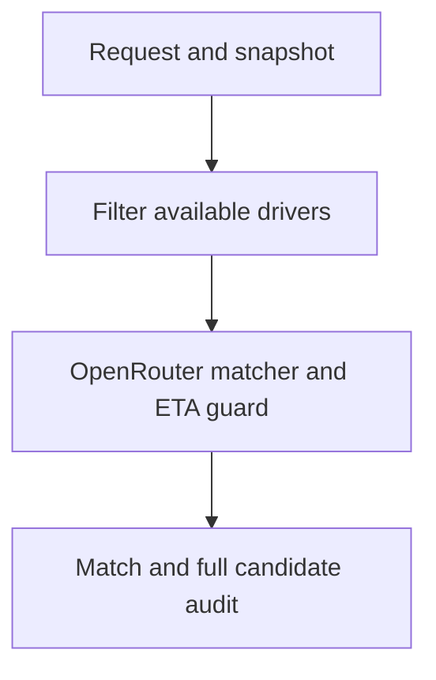

# AI Agent Ride Matcher

A two-node LangGraph workflow that filters unavailable drivers before calling OpenRouter, then independently verifies the model's choice against supplied road pickup minutes. Every original candidate has a human-readable audit entry.

Public repository: https://github.com/bhavesh-210/ai-agent-ride-matcher

## Submission status

- Implemented: LangGraph, Pydantic v2 validation, immutable state updates, OpenRouter integration, ETA guard, per-candidate audit, CLI, and optional FastAPI.
- Assignment CSVs loaded, validated and published with explicit authorization: **20 requests and 80 candidate rows**.
- **20 tests pass**, including the actual bridge detour, unavailable drivers, all-request evaluation, and source-ID mismatch.
- Actual-data offline evaluation: **19 matches, 1 unmatched request, 7 strict ETA improvements over the nearest available driver**.
- Still pending: successful real OpenRouter API run, matching Activity screenshot, and genuine Claude Code Plan Mode excerpt.
- Evidence files containing `offline` or `offline_assignment_evaluation_no_api_call` are explicitly NOT live API evidence.
- Langfuse is deferred; no Langfuse tracing is claimed.

## Install and verify

Python 3.11+; run from the project root:

```bash
python3 -m venv .venv
source .venv/bin/activate
python -m pip install -r requirements.txt
python -m pytest -q
python -m ride_matcher.evaluate
```

## Actual-data evaluation

The private assignment files contain 20 requests and 80 driver rows. Local evaluation produces 19 matches and one unmatched request. Four candidate rows use a request ID absent from the requests file. IDs are joined exactly; the matcher never guesses a correction.

Seven requests have a strictly faster road ETA than the nearest available driver. In the actual bridge example, the closer available driver takes 16 minutes due to a bridge-ramp detour; a farther available driver takes 4 minutes and wins. A separate freight/rail case chooses a 3-minute driver over a nearer 9-minute driver. Source flags are not used to rank candidates.

An aggregate report is published in `evidence/assignment-summary.json`. The user explicitly authorized public publication of the supplied assignment CSVs and detailed offline audit outputs. They are included in this repository; API credentials remain excluded.

To reproduce locally, place the request CSV at `data/source/requests.csv` and the candidate CSV at `data/source/drivers.csv`, then run:

```bash
python -m ride_matcher.evaluate
```

For a single request, use its actual request ID in the commands below.

## Real OpenRouter API run — required before submission

Create/save your key privately at https://openrouter.ai/workspaces/default/keys . It must remain in your local gitignored `.env` and must never be pasted into a README, screenshot, commit or command argument.

```bash
cp .env.example .env
python -m ride_matcher --list-models
```

Edit `.env` locally, setting `OPENROUTER_API_KEY` and an available `OPENROUTER_MODEL` ID ending `:free`. Do not assume old model slugs still exist. Free models may have quota or availability limits.

```bash
python -m ride_matcher --requests data/source/requests.csv --drivers data/source/drivers.csv --request-id YOUR_REQUEST_ID --output evidence/live-run.json
```

Success requires `verification: model_verified`, the actual returned/requested model IDs, generation ID, UTC timestamps and latency. A failed call or incorrect proposal produces visible fallback and nonzero CLI exit status; that does not satisfy the required successful call.

After the successful run, open https://openrouter.ai/activity and locate that call. Match the recorded UTC time (convert to the page timezone), model and generation metadata. Save a genuine screenshot as `evidence/openrouter-activity.png`, cropping unrelated account details without hiding the required evidence. Then add:

```markdown

```

Review the live JSON and screenshot for identifiers or location data before publishing. Detailed live JSON is gitignored by default; publish a sanitized version or obtain explicit source-data publication authorization. No screenshot or live run has been fabricated or supplied in this repository.

## Source data and explicit mapping

The supplied assignment files are preserved byte-for-byte as `data/source/requests.csv` and `data/source/drivers.csv`. Their original titles are:

- Uber Ride Requests Test Set (week of 3-9 March 2025).csv
- Uber Candidate Drivers Snapshot (week of 3-9 March 2025).csv

| Source CSV fields | Validated model fields |
|---|---|
| pickup_lat, pickup_lng | pickup_coordinates.lat, pickup_coordinates.lon |
| driver_lat, driver_lng | coordinates.lat, coordinates.lon |
| driver_status | status |
| straight_line_km | straight_line_distance_km |
| road_pickup_minutes | actual_pickup_time_minutes |
| request_id, driver_id, rider_id | Preserved verbatim |
| route_note | Preserved in canonical candidate audit |

Source timestamps, zones, river sides and scenario flags remain in the original CSVs. They do not override the numeric road ETA or status. Missing road ETA is unavailable for ranking; zero is a valid ETA. JSON example input remains supported. Input-byte hashes and dataset join warnings are saved with individual CLI run evidence.

### Data quality findings and gap pushed back on

One request has no matching candidate ID and four candidate rows reference an absent request ID. The matcher returns no match and reports orphan rows instead of silently repairing the source. The `distance_time_disagree` flags conflict with strict numeric ETA improvement on 10 joinable requests; numeric road times and available status are authoritative.

“Guaranteed pickup time” cannot be promised by a historical snapshot or LLM. The guard guarantees selection of the lowest supplied ETA among eligible routable candidates, not actual physical arrival. Historical status is not live availability. Production dispatch requires fresh routing/status and atomic reservation.

Seven requests show a strict ETA improvement; equal-ETA ties are not counted as improvements. Detailed offline per-request reports are published in `evidence/assignment-evaluation.json`, with individual samples in `evidence/assignment-bridge-offline.json` and `evidence/assignment-sample-offline.json`. These are not live API evidence.

## Two-node architecture



Node 1 filters by available status. Node 2 removes missing routes, requests a structured OpenRouter proposal, checks the driver ID and copied ETA against a deterministic minimum, and produces the audit. Equal road ETAs use driver_id ascending; distance never determines ranking or ties.

Pydantic models are frozen, candidate collections are tuples, and state updates and final graph output are explicitly validated. Duplicate driver IDs within a request, cross-request candidates, invalid statuses, negative ETAs and nonfinite numbers are rejected.

Unavailable profiles and rider identity are not sent to the model. Incorrect model proposals are retained but visibly overridden. Model rationale is an untrusted proposal; the canonical audit is produced from validated metrics. Provider failure logs do not contain response bodies, credentials or request headers.

## Planning evidence

Implementation plan authored during development (NOT a Claude Code transcript):

1. Validate source columns and exact request-ID joins; report source anomalies.
2. Filter unavailable drivers before the model.
3. Request structured selection using supplied road minutes.
4. Independently verify the driver ID and ETA.
5. Produce complete candidate audit and save provider metadata.

### Genuine Claude Code Plan Mode excerpt

PENDING. Open this repository in your Claude Code, use `CLAUDE_CODE_PROMPT.md` in Plan Mode, review its actual proposal, then paste a short real excerpt here. Do not relabel the implementation plan above as a Claude session.

## Optional local API

```bash
uvicorn ride_matcher.api:app --reload
```

Use http://127.0.0.1:8000/docs, POST `/match` with `{ "request": <request object>, "all_candidates": [<driver objects>] }`. Derived state fields are rebuilt. Credentials come from the server environment. This is an unauthenticated local development endpoint, not production dispatch. It does not reserve drivers or prevent concurrent double dispatch; those require atomic storage operations and fresh status checks.

## Remaining submission checklist

- [x] Public GitHub repository with source and README
- [x] Explicit CSV loader and private validation of actual assignment files
- [x] Explicit authorization received; source CSVs and detailed offline audits published
- [x] Two-node graph with pre-model availability filter
- [x] Road ETA guard, bridge test and complete audit
- [x] Offline run on actual data, all-request evaluation, and public aggregate summary
- [ ] Private key configured locally and current :free model selected
- [ ] Successful live API run with `model_verified`
- [ ] Matching genuine OpenRouter Activity screenshot committed
- [ ] Genuine Claude Code Plan Mode excerpt added

Before any local commit, `git check-ignore .env` should print `.env`, and `git ls-files .env` should print nothing. Never commit an API key. The included `.env.example` contains no credentials.

Validation: 20 tests pass locally on Python 3.12.14 with the supplied assignment CSVs. Without them, the 16 self-contained tests run and four assignment integration cases skip. Tests include synthetic and actual bridge cases, ETA/availability invariants across all requests, source-ID mismatch, malformed proposals, provider failure and mocked HTTP integration. Mocked integration is not proof of a live call. `requirements-tested.txt` records directly used versions; `requirements.txt` defines compatible ranges.
