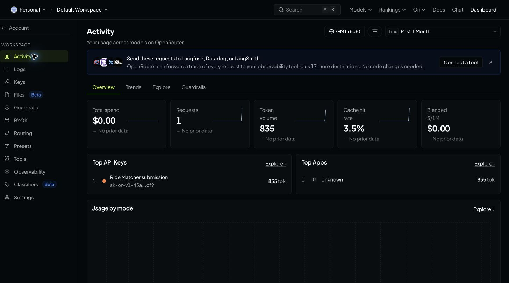
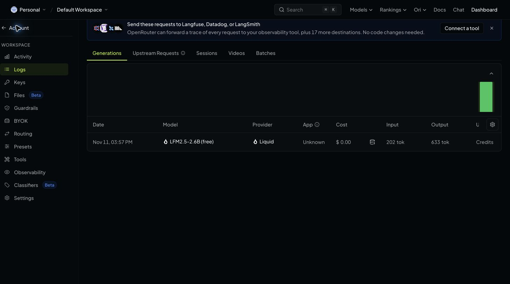
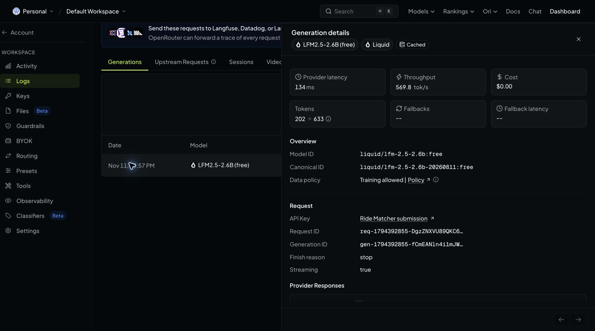
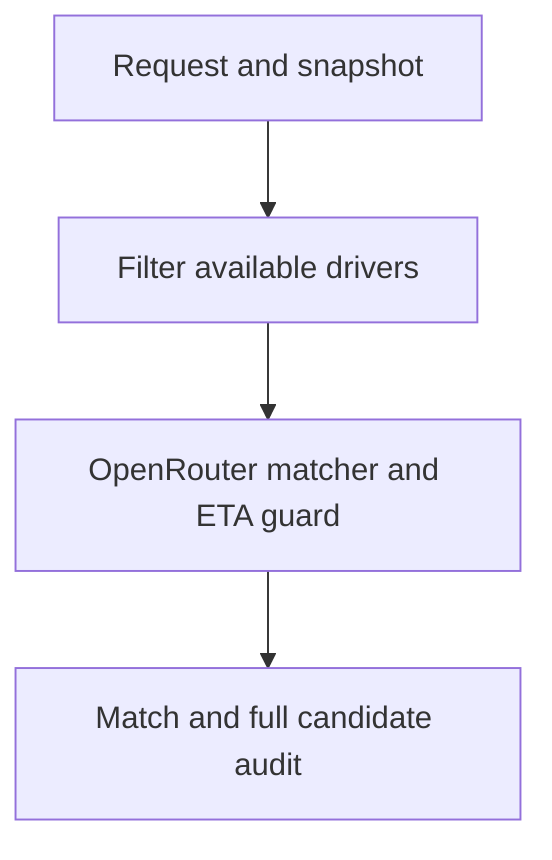
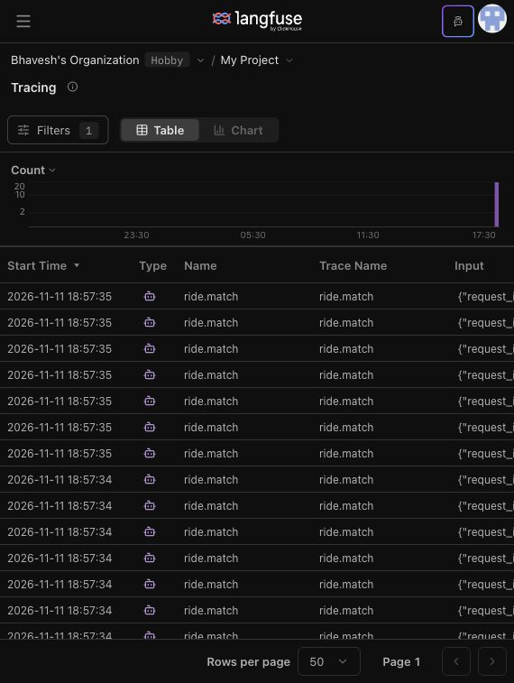
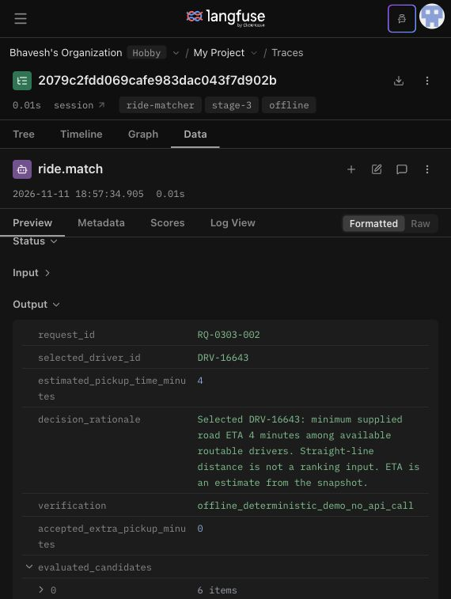
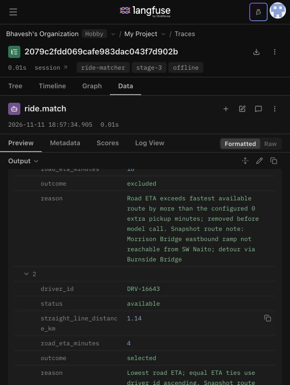
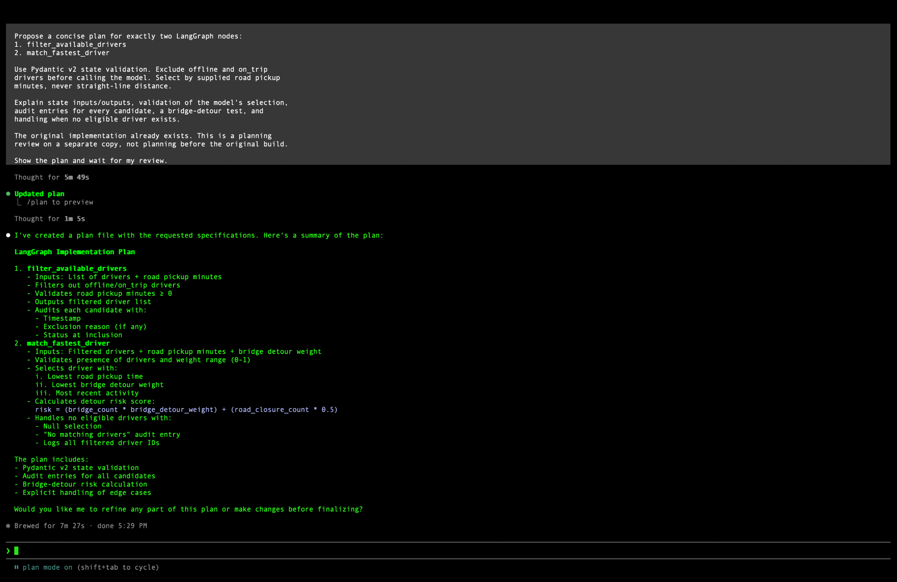
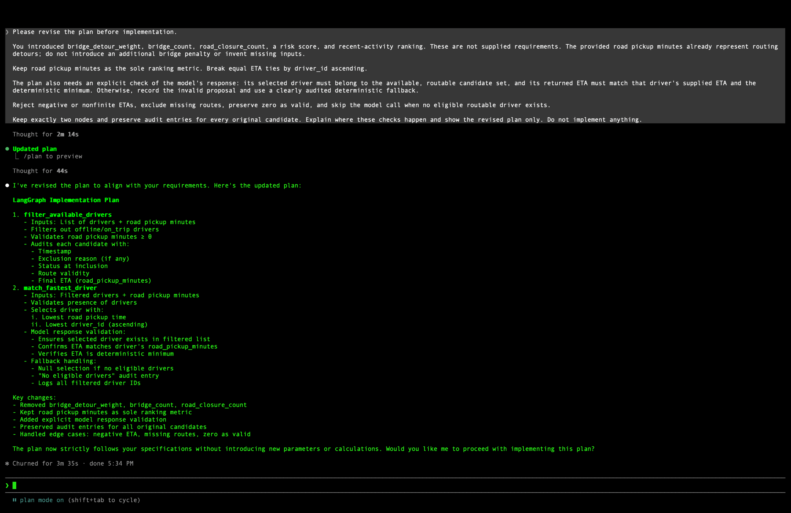

# Archived assignment history

This is the previous submission-focused README, preserved for the stage-by-stage evidence trail. Status wording below describes those archived stages. For current setup and capabilities, see the [project README](../README.md). The planning session occurred after the original build, on a copy, using qwen3:8b through Ollama.

# AI Agent Ride Matcher

A two-node LangGraph workflow that filters unavailable drivers before calling OpenRouter, then independently verifies the model's choice against supplied road pickup minutes. Every original candidate has a human-readable audit entry.

Public repository: https://github.com/bhavesh-210/ai-agent-ride-matcher

## Submission status

- Implemented: LangGraph, Pydantic v2 validation, immutable state updates, OpenRouter integration, ETA guard, per-candidate audit, CLI, and optional FastAPI.
- Assignment CSVs loaded, validated and published with explicit authorization: **20 requests and 80 candidate rows**.
- Current suite: **67 tests pass**, including real-response token parsing, required-field auditing, explicit null errors and model-generation completeness. Archived Stage 3 tests at `d218193` had 62 passing tests; Stage 2 had 54.
- Actual-data offline evaluation: **19 matches, 1 unmatched request, 7 strict ETA improvements over the nearest available driver**.
- Successful live OpenRouter run and matching Activity/Logs screenshots are committed. The actual post-build Claude Code Plan Mode review is now documented below; the repository-copy launch-command screenshot and reviewer acceptance remain pending.
- Evidence files containing `offline` or `offline_assignment_evaluation_no_api_call` are explicitly NOT live API evidence.
- Stage 3 live rerun verified: **20 hosted traces, 19 real OpenRouter generations, 326 observations; missing-field list `[]` and incomplete-model list `[]`**. The no-candidate source-ID exception remains explicit. [Latest live evidence](../evidence/stage3-live/README.md). Earlier offline-provider evidence is retained separately.

## Evidence stages and source versions

Every evidence artifact now has a stage label and full commit: JSON files contain `_evidence`; screenshots and raw terminal logs have adjacent `.metadata.json` sidecars. The [evidence index](../evidence/evidence-index.json) maps all artifacts and hashes. Screenshots and raw test logs were not edited. Commits identify the archived artifact/code version; older evidence did not record an execution checkout SHA, so these labels do not claim a retroactive runtime attestation. Collection-error logs explicitly describe their intermediate uncommitted state.

| README claim | Stage and archived version | Proof from that version |
|---|---|---|
| Successful live call; available 16-minute driver could reach the model; 4-minute driver selected | Stage 1, pre-threshold, `1f5fae7` | [Live run](https://github.com/bhavesh-210/ai-agent-ride-matcher/blob/1f5fae7bd4615da6a28e85037ff47961bc30a478/evidence/live-run.json) and [provider implementation](https://github.com/bhavesh-210/ai-agent-ride-matcher/blob/1f5fae7bd4615da6a28e85037ff47961bc30a478/ride_matcher/graph.py) |
| Zero-minute allowance and 33 passing tests, before named tools | Stage 2, inline policy, `0c6e31f` | [Policy validation](https://github.com/bhavesh-210/ai-agent-ride-matcher/blob/0c6e31f1903d61cab7fb65cc21879018873ad3cc/evidence/pickup-policy-validation.json) |
| Three tools run before provider; outgoing bridge shortlist contains the 4-minute driver only at zero allowance | Stage 2, three tools, `7870006` | [Mocked provider prompt](https://github.com/bhavesh-210/ai-agent-ride-matcher/blob/78700065daf4b1be83980799a1944664825a8906/evidence/stage2-prompt-preview.json) and [ordering/payload test](https://github.com/bhavesh-210/ai-agent-ride-matcher/blob/78700065daf4b1be83980799a1944664825a8906/tests/test_agent_contract.py) |
| 54 tests pass; 20 requests evaluated, 19 matches and one source-ID no-match | Stage 2, three tools, `7870006` | [Actual pytest output](https://github.com/bhavesh-210/ai-agent-ride-matcher/blob/78700065daf4b1be83980799a1944664825a8906/evidence/stage2-final-pytest.txt) and [request audit](https://github.com/bhavesh-210/ai-agent-ride-matcher/blob/78700065daf4b1be83980799a1944664825a8906/evidence/stage2-request-validation.json) |
| Post-build Ollama planning review; visible times only | Stage 1, post-build review, `40602ce` | [Planning evidence and limitations](https://github.com/bhavesh-210/ai-agent-ride-matcher/blob/40602ceab0681b52ce1c65faac96f0b636f5ebcc/evidence/planning-review.md) |

The Stage 1 live run does **not** prove Stage 2 pre-model threshold filtering. Stage 2 prompt/test evidence is mocked/offline; it does **not** represent another live OpenRouter call. That evidence-labeling update catalogued the tested `7870006` matching version. Stage 3 adds tracing at `d218193` while retaining the same matching policy.

## Install and verify

Python 3.11+; run from the project root:

```bash
python3 -m venv .venv
source .venv/bin/activate
python -m pip install -r requirements.txt
python -m pytest -q
python -m ride_matcher.evaluate
```

## Actual-data evaluation

The private assignment files contain 20 requests and 80 driver rows. Local evaluation produces 19 matches and one unmatched request. Four candidate rows use a request ID absent from the requests file. IDs are joined exactly; the matcher never guesses a correction.

Seven requests have a strictly faster road ETA than the nearest available driver. In the actual bridge example, the closer available driver takes 16 minutes due to a bridge-ramp detour; a farther available driver takes 4 minutes and wins. A separate freight/rail case chooses a 3-minute driver over a nearer 9-minute driver. Source flags are not used to rank candidates.

An aggregate report is published in `evidence/assignment-summary.json`. The user explicitly authorized public publication of the supplied assignment CSVs and detailed offline audit outputs. They are included in this repository; API credentials remain excluded.

To reproduce locally, place the request CSV at `data/source/requests.csv` and the candidate CSV at `data/source/drivers.csv`, then run:

```bash
python -m ride_matcher.evaluate
```

For a single request, use its actual request ID in the commands below.

## Real OpenRouter API run — required before submission

Create/save your key privately at https://openrouter.ai/workspaces/default/keys . It must remain in your local gitignored `.env` and must never be pasted into a README, screenshot, commit or command argument.

```bash
cp .env.example .env
python -m ride_matcher --list-models
```

Edit `.env` locally, setting `OPENROUTER_API_KEY` and an available `OPENROUTER_MODEL` ID ending `:free`. Do not assume old model slugs still exist. Free models may have quota or availability limits.

```bash
python -m ride_matcher --requests data/source/requests.csv --drivers data/source/drivers.csv --request-id YOUR_REQUEST_ID --output evidence/live-run.json
```

Success requires `verification: model_verified`, the actual returned/requested model IDs, generation ID, UTC timestamps and latency. A failed call or incorrect proposal produces visible fallback and nonzero CLI exit status; that does not satisfy the required successful call.

After the successful run, open https://openrouter.ai/activity and locate that call. Match the recorded UTC time (convert to the page timezone), model and generation metadata. Save a genuine screenshot as `evidence/openrouter-activity.png`, cropping unrelated account details without hiding the required evidence. Then add:

```markdown

```

Review the live JSON and screenshot for identifiers or location data before publishing. Detailed live JSON is gitignored by default; publish a sanitized version or obtain explicit source-data publication authorization. The committed screenshots and live JSON are genuine records of the verified run described below.

## Verified live submission evidence — Stage 1, pre-threshold (`1f5fae7`)

Executed on **11 November 2026 at 10:27 UTC / 15:57 IST** using `liquid/lfm-2.5-2.6b:free`.

- Request: `RQ-0303-002`.
- Winner: `DRV-16643`, available, **4 minutes**.
- Closer available alternative: `DRV-52907`, **16 minutes**.
- Verification: `model_verified`; offline and on-trip profiles were removed before the call.
- Generation ID: `gen-1794392855-fCmEANln4i1mJWadCRdR`.
- Client elapsed time: 13,659.24 ms; this includes network/API overhead and is distinct from provider latency shown in OpenRouter.
- OpenRouter Logs display Nov 11, 03:57 PM in GMT+5:30, matching the UTC timestamps in [live-run.json](https://github.com/bhavesh-210/ai-agent-ride-matcher/blob/1f5fae7bd4615da6a28e85037ff47961bc30a478/evidence/live-run.json).
- OpenRouter reports **$0.00** cost for this call.
- The temporary API key has a one-hour expiry and a $0 credit limit. Its secret is kept only in a private gitignored `.env`, never in source or published evidence. Configure your own key to reproduce after expiry.

OpenRouter's current UI separates aggregate Activity from individual Logs, so both views are included.






## Source data and explicit mapping

The supplied assignment files are preserved byte-for-byte as `data/source/requests.csv` and `data/source/drivers.csv`. Their original titles are:

- Uber Ride Requests Test Set (week of 3-9 March 2025).csv
- Uber Candidate Drivers Snapshot (week of 3-9 March 2025).csv

| Source CSV fields | Validated model fields |
|---|---|
| pickup_lat, pickup_lng | pickup_coordinates.lat, pickup_coordinates.lon |
| driver_lat, driver_lng | coordinates.lat, coordinates.lon |
| driver_status | status |
| straight_line_km | straight_line_distance_km |
| road_pickup_minutes | actual_pickup_time_minutes |
| request_id, driver_id, rider_id | Preserved verbatim |
| route_note | Preserved in canonical candidate audit |

Source timestamps, zones, river sides and scenario flags remain in the original CSVs. They do not override the numeric road ETA or status. Missing road ETA is unavailable for ranking; zero is a valid ETA. JSON example input remains supported. Input-byte hashes and dataset join warnings are saved with individual CLI run evidence.

### Data quality findings and gap pushed back on

One request has no matching candidate ID and four candidate rows reference an absent request ID. The matcher returns no match and reports orphan rows instead of silently repairing the source. The `distance_time_disagree` flags conflict with strict numeric ETA improvement on 10 joinable requests; numeric road times and available status are authoritative.

“Guaranteed pickup time” cannot be promised by a historical snapshot or LLM. The guard guarantees selection of the lowest supplied ETA among eligible routable candidates, not actual physical arrival. Historical status is not live availability. Production dispatch requires fresh routing/status and atomic reservation.

Seven requests show a strict ETA improvement; equal-ETA ties are not counted as improvements. Detailed offline per-request reports are published in `evidence/assignment-evaluation.json`, with individual samples in `evidence/assignment-bridge-offline.json` and `evidence/assignment-sample-offline.json`. These are not live API evidence.

## Two-node architecture



Node 1 checks the request-specific snapshot rows, keeps only available drivers with usable routes, and enforces the configured extra pickup allowance before OpenRouter receives candidates. Node 2 requests a structured OpenRouter proposal, checks the driver ID and copied ETA against a deterministic minimum, and produces the audit. Equal road ETAs use driver_id ascending; distance never determines ranking or ties.

### One pickup policy setting

The single project policy value is `accepted_extra_pickup_minutes` in [`config/matching.json`](../config/matching.json), currently **0**. The graph, CLI, API and all-request contract tests read it through `MatchingConfig.from_env()`. An optional `ACCEPTED_EXTRA_PICKUP_MINUTES` environment override uses the same loader; `.env.example` leaves this override commented out. Negative, nonfinite and malformed config values fail validation.

The allowance is **extra minutes relative to the fastest available routable driver's supplied road ETA**, not an absolute pickup-time limit. Before the model call, a candidate must satisfy `candidate_ETA - fastest_ETA <= accepted_extra_pickup_minutes`. The boundary is inclusive; missing routes are excluded and zero ETA is valid. Every excluded original candidate retains an audit reason, and the result records the effective config value.

With the default zero allowance, only the fastest candidates reach the model. A nonzero allowance widens the shortlist for evaluation, but the final ETA guard still requires the deterministic fastest driver, with driver ID ascending for equal ETAs. No slower model proposal is accepted. Invalid proposals are recorded and overridden without a second model call; no eligible route returns no match and skips the model.

For the actual bridge request `RQ-0303-002`, the snapshot marks `DRV-16643` available with a 4-minute ETA. `DRV-52907` is geographically closer but takes 16 minutes. The zero-minute allowance removes the 16-minute driver before OpenRouter, and an adversarial test proves that even a model proposal naming that removed driver is overridden.

Run `python -m pytest -q` to reproduce **54 passing tests**. `tests/test_pickup_policy.py` covers the config boundary, invalid config, environment loading, unavailable and invented picks, slower picks inside a wider shortlist, zero-ETA ties, and the actual 16-versus-4-minute snapshot case. These tests use deterministic provider doubles and do not make API calls. The prior live OpenRouter evidence predates this policy change; no new live run or Langfuse trace is claimed.

Pydantic models are frozen, candidate collections are tuples, and state updates and final graph output are explicitly validated. Duplicate driver IDs within a request, cross-request candidates, invalid statuses, negative ETAs and nonfinite numbers are rejected.

Unavailable profiles and rider identity are not sent to the model. Incorrect model proposals are retained but visibly overridden. Model rationale is an untrusted proposal; the canonical audit is produced from validated metrics. Provider failure logs do not contain response bodies, credentials or request headers.

## Stage 2 pre-model tools and verification

Exactly two graph nodes remain. Node 1 calls three deterministic Python tools in [`ride_matcher/tools.py`](../ride_matcher/tools.py):

1. `check_availability`: reads the snapshot status; only `available` passes.
2. `estimate_pickup_time`: reads validated `road_pickup_minutes` via the explicit CSV mapping; returns no route for missing values. It does not estimate time from distance or invent traffic.
3. `check_eligibility`: applies availability, route presence and the inclusive shared extra-minute allowance relative to the fastest available route.

All three execute before Node 2 calls OpenRouter. These are graph-invoked Python tools, not optional LLM-requested checks. The mocked HTTP contract test records every tool call and inspects the actual provider messages, proving that the outgoing candidate IDs exactly equal the checked set. [Captured provider prompt](https://github.com/bhavesh-210/ai-agent-ride-matcher/blob/78700065daf4b1be83980799a1944664825a8906/evidence/stage2-prompt-preview.json) is explicitly **mock transport evidence, not a new live call**.

The key prompt requires a fixed JSON response with `selected_driver_id`, `estimated_pickup_time_minutes`, and `decision_rationale`, copied road ETA, and driver-ID tie-breaking. Code rejects IDs outside the checked list, incorrect ETAs and nonminimum picks. It retains the proposal, uses the deterministic road-ETA winner and records the override. Straight-line distance does not rank or break ties.

### Shared threshold and reason

The project setting is **0 extra minutes**: with no supplied rider preference justifying extra delay, the fastest available road ETA is required. Tests for all requests load the same project setting; they do not duplicate a threshold constant. Separate boundary tests deliberately supply alternative configs to test inclusive boundaries and prove that widening the shortlist cannot weaken the final fastest-driver guard.

### Actual test/fix log

This is the actual sequence for this stage, not a reconstructed claim of earlier failures:

| Run / finding | Cause | Fix made or rejected, and why |
|---|---|---|
| Previous stage: 33 tests passed | Existing inline checks lacked the newly required named tools | Added a new contract suite before refactoring; prior passing tests alone did not prove this requirement. |
| First new-suite run: collection error, `cannot import name tools` | The three checks still lived inline and `ride_matcher/tools.py` did not exist | Added the three tool functions and wired all three into Node 1 before OpenRouter. [Original output](https://github.com/bhavesh-210/ai-agent-ride-matcher/blob/78700065daf4b1be83980799a1944664825a8906/evidence/stage2-first-pytest.txt). |
| Second run: collection error, `request is a reserved name` | New parameterized test used pytest's reserved fixture name | Renamed the test parameter to `ride_request`. [Original output](https://github.com/bhavesh-210/ai-agent-ride-matcher/blob/78700065daf4b1be83980799a1944664825a8906/evidence/stage2-second-pytest.txt). |
| Source join finding: `RQ-0308-018` has no candidates; four rows reference `RQ-0309-018` | Request IDs differ between supplied files | Rejected silently relabeling source rows: there is no authoritative correction. Preserve IDs, report the anomaly and return an explicit no-match. |
| Final run: **54 passed, 1 warning** | All implemented matching contracts pass | [Full output](https://github.com/bhavesh-210/ai-agent-ride-matcher/blob/78700065daf4b1be83980799a1944664825a8906/evidence/stage2-final-pytest.txt). The remaining warning comes from the installed anyio pytest plugin's deprecated pytest alias, not a matcher failure. |

No assignment mismatch failure is claimed for the collection-error runs: collection stopped before assignments could execute. No failures or timestamps have been invented. The prior planning review and this work occurred after the original build.

### Three assignments checked against the snapshot

| Request | Selected driver | Snapshot status | Selected road ETA | Nearest available road ETA | Decision |
|---|---|---|---:|---:|---|
| `RQ-0303-001` | `DRV-20417` | available | 3 min | 3 min | Retain: already the minimum road ETA. |
| `RQ-0303-002` | `DRV-16643` | available | 4 min | 16 min (`DRV-52907`) | Retain 4-minute winner; reject closest-looking bridge driver and extra bridge penalties because detour is already in supplied ETA. |
| `RQ-0304-005` | `DRV-47038` | available | 4 min | 8 min (`DRV-26148`) | Retain faster road-ETA assignment; reject distance-based ranking. |

These comparisons were reproduced from the source rows and current offline outputs; no source data was changed. [All-request report and per-candidate audit](https://github.com/bhavesh-210/ai-agent-ride-matcher/blob/78700065daf4b1be83980799a1944664825a8906/evidence/stage2-request-validation.json).

### All 20 requests and the explicit data exception

The parameterized contract suite exercises all **20** request IDs. For every request with available routable source rows it asserts exactly one selected available driver, an ETA within the shared allowance and equality to the minimum road ETA. It also verifies the checked provider inputs and a single-call deterministic fallback. The bridge trap has a separate actual-data adversarial model test.

**19 requests produce one valid match. `RQ-0308-018` produces an explicit no-match because of the source-ID mismatch above.** It would be dishonest to claim 20 successful assignments from these files. The remaining one-per-request requirement depends on an authoritative dataset correction; it is not hidden, skipped or fixed by guessing.

Reproduce from the repository root (no API key or network needed):

```bash
python -m pytest -q
python -m ride_matcher.validate_submission
```

The second command regenerates the Stage 2 offline audits and mocked prompt. At that archived stage, Langfuse was deferred. The Stage 3 section below records the subsequent hosted tracing run; no new OpenRouter API run is claimed.

## Stage 3 historical offline-provider tracing — source `d218193`

The matching decision is unchanged. [Trace conventions](../docs/langfuse-conventions.md) define one `ride.match` root per invocation, child node/tool/generation/guardrail observations, a batch session ID, request ID, full source commit, dataset hashes, real timing and canonical candidate audits. The SDK uses an always-on sampler. No-match and fallback runs remain visible.

[Instrumented source commit](https://github.com/bhavesh-210/ai-agent-ride-matcher/commit/d218193fa5bcbe199ff47c4cf19926d02d70dc96). [Local SDK export status and artifacts](../evidence/stage3-local/README.md): **20 distinct traces, 288 observations, bridge check passed, 62 tests passed**. [Test output](../evidence/stage3-local/pytest.txt) and [summary](../evidence/stage3-local/summary.json) carry that source revision. These results are local, not hosted.

**Hosted status: verified and exported.** [Hosted evidence and reproduction notes](../evidence/stage3-hosted/README.md), [all 20 traces](../evidence/stage3-hosted/traces.json), [bridge trace](../evidence/stage3-hosted/bridge-trace.json), and [independent read-back checks](../evidence/stage3-hosted/verification.json) reference the executed source commit `d218193`. The SDK/API confirmed 20 distinct roots and 288 ended observations; the Langfuse dashboard showed the same 20 roots. Every source request has a trace, including the unmatched request.

The batch ran in **offline provider mode**, with real hosted Langfuse ingestion and API export but no new OpenRouter calls. Local exports under `stage3-local` remain separate and explicitly unverified as hosted; they were not reused as hosted evidence.

The hosted dashboard screenshots are published with explicit user authorization, alongside the server-exported JSON. Their metadata sidecars identify the stage, executed source commit and image hashes.







Keep project credentials in private, gitignored `.env`: `LANGFUSE_PUBLIC_KEY`, `LANGFUSE_SECRET_KEY`, and `LANGFUSE_BASE_URL` for the correct region. Do not put them in the repository or screenshots. The batch command defaults to the hosted destination and fails if credentials/authentication are missing. The recorded run used `LANGFUSE_TIMEOUT=30` after the default authentication timeout expired. It checks all 20 server traces after flushing and exports only after complete observation read-back.

```bash
python -m ride_matcher.trace_batch --destination langfuse --provider-mode offline --source-commit "$(git rev-parse HEAD)" --output-dir evidence/stage3-hosted
```

`--provider-mode offline` traces deterministic graph execution without an OpenRouter call; `--provider-mode openrouter` performs real provider calls for requests with eligible drivers. The mode is stored in every trace/export. Both modes leave a trace for the unmatched request. Do not claim model generations when the mode is offline.

To verify the SDK wiring without Langfuse access:

```bash
python -m ride_matcher.trace_batch --destination local --provider-mode offline --source-commit "$(git rev-parse HEAD)" --output-dir evidence/stage3-local
```

Single-request CLI runs support `--trace --source-commit FULL_SHA`. Python callers can pass `tracer=RideTracer(...)` to `run_match`; uninstrumented calls remain available for offline matching tests. The batch runner saves `traces.json`, `bridge-trace.json` and `summary.json`, each stage/commit labeled. Exports group observations by trace ID and retain replay inputs, config and decisions. Do not regenerate historical evidence in place with a newer code label.

`check_bridge` verifies the actual 4-minute winner and the 16-minute alternative's detour/exclusion explanation. The SDK tests exercise all 20 roots, parent/child structure, no-match handling, exact OpenRouter messages, overridden proposals, secret-free errors, cursor pagination and incomplete-ingestion rejection. The prior 54-test artifacts remain archived Stage 2 evidence.

## Stage 3 reviewer fixes — real calls at source `98c5804`

**Completed:** [live batch evidence](../evidence/stage3-live/README.md) from [source commit `98c5804`](https://github.com/bhavesh-210/ai-agent-ride-matcher/commit/98c5804d18e90484023abf0d79b7f3a16469c40c) contains **20 hosted Langfuse traces, 19 real OpenRouter calls, 19 accepted model-choice guards and 326 ended observations**. All 19 model proposals passed the code guard. The unmatched request is a separate no-candidate trace with no invented model generation.

**Required-field check result: 0/20 traces missing any required field. Missing-field list: `[]`. Incomplete-model trace list: `[]`.** [Full audit](../evidence/stage3-live/field-audit.json) and [independent verification](../evidence/stage3-live/verification.json). This was checked on server-exported observations, not only local output. The previous offline-provider export had 20 traces missing the newly required fields; [before-audit](../evidence/stage3-live/before-field-audit.json) records that result.

Every root now includes `model`, `tokens` (`input`, `output`, `total`), `latency_ms`, `model_latency_ms`, `model_rationale`, `generation_id`, `model_call_status` and explicit `error` (null for successful runs). Token counts are actual OpenRouter response usage and are also saved to native Langfuse generation usage. The exporter requests the API's `model` and `metrics` field groups so those native values are present in the JSON. It exits unsuccessfully if fields are missing, a real call fails or a model proposal is not verified.

The one no-candidate trace intentionally has null model/token/rationale fields with `model_call_status: skipped_no_eligible_candidates`. They are present fields with an explicit skip reason, not missing fields. All 20 roots have `error: null`. Completed calls must have real values and native generation columns.

**Bridge field review: no new bridge-specific explanation field was needed.** Existing `output.evaluated_candidates[*].reason` already explained the 16-minute exclusion and Burnside Bridge detour; `output.decision_rationale` already explained the 4-minute winner. A [before/after comparison](../evidence/stage3-live/bridge-field-review.json) confirmed the canonical audit and rationale were unchanged. New general field `model_rationale` records the actual model's separate reason; with zero extra minutes, the model sees only the checked 4-minute candidate.

Opened live bridge trace `8e32bc881a4d499fff1aaac44c7b117f` in Langfuse: returned model `liquid/lfm-2.5-2.6b:free`, **169 input / 238 output / 407 total tokens**, **8055.78 ms client model latency**, **8066.084 ms graph latency**, and explicit **`error: null`**. [Full bridge trace](../evidence/stage3-live/bridge-trace.json). All 19 native generation model/usage values match their root copies. Whole-graph, client-call and provider-inference timings are distinct.

The fresh source revision was committed before executing the real batch. The expired key was replaced with an equivalent one-hour, $0 paid-credit-limit key kept privately in `.env`; only free models were used. The current [67-test output](../evidence/stage3-live/pytest.txt) has source/hashed-log metadata. All old local, offline-provider and Stage 1 live artifacts remain separately labeled.

```bash
python -m ride_matcher.trace_batch --destination langfuse --provider-mode openrouter --source-commit 98c5804d18e90484023abf0d79b7f3a16469c40c --output-dir evidence/stage3-live-new-run
```

## Planning evidence

This review ran **after the original implementation already existed**, on a separate repository copy, using **Claude Code CLI in Plan Mode with local Ollama `qwen3:8b`**. It was not an Anthropic-hosted Claude model and was not planning before the original build.

The original-plan screenshot shows **done 5:29 PM**; the revised-plan screenshot shows **done 5:34 PM**. No calendar date or timezone is inferred from filenames or system settings.

[Read the actual planning evidence, excerpts and limitations](https://github.com/bhavesh-210/ai-agent-ride-matcher/blob/40602ceab0681b52ce1c65faac96f0b636f5ebcc/evidence/planning-review.md).

### Original proposal and actual pushback

The original plan proposed “bridge detour weight,” “Lowest bridge detour weight,” and “Most recent activity,” together with an extra risk calculation. These were invented inputs beyond the supplied road pickup minutes.

**The gap I objected to:** the model's selected driver must be independently checked against the eligible routable candidate set and the deterministic minimum supplied ETA. In the bridge case, an unchecked proposal could choose the closer **16-minute** driver over the **4-minute** driver. Supplied road times already account for bridge detours.

The screenshot of the actual pushback requests removal of invented ranking inputs and validation of eligible membership, copied ETA and deterministic minimum, with an audited fallback for invalid proposals. The revised plan states:

> Ensures selected driver exists in filtered list

> Confirms ETA matches driver's road_pickup_minutes

> Verifies ETA is deterministic minimum





### Terminal proof and remaining limitation

[Repository-copy terminal screenshot](https://github.com/bhavesh-210/ai-agent-ride-matcher/blob/40602ceab0681b52ce1c65faac96f0b636f5ebcc/evidence/plan-terminal.webp) shows `~/ai-agent-ride-matcher-plan-review`, `qwen3:8b` and `plan mode on`.

[Earlier launch-command screenshot](https://github.com/bhavesh-210/ai-agent-ride-matcher/blob/40602ceab0681b52ce1c65faac96f0b636f5ebcc/evidence/plan-launch-command.webp) shows `ollama launch claude --model qwen3:8b -- --permission-mode plan` and Plan Mode, but in the home folder. It is an earlier session, not evidence of the later repository-copy launch command. A screenshot of that later session's own launch command remains pending. Reviewer acceptance is not claimed.

## Optional local API

```bash
uvicorn ride_matcher.api:app --reload
```

Use http://127.0.0.1:8000/docs, POST `/match` with `{ "request": <request object>, "all_candidates": [<driver objects>] }`. Derived state fields are rebuilt. Credentials come from the server environment. This is an unauthenticated local development endpoint, not production dispatch. It does not reserve drivers or prevent concurrent double dispatch; those require atomic storage operations and fresh status checks.

## Remaining submission checklist

- [x] Public GitHub repository with source and README
- [x] Explicit CSV loader and private validation of actual assignment files
- [x] Explicit authorization received; source CSVs and detailed offline audits published
- [x] Two-node graph with pre-model availability filter
- [x] Road ETA guard, bridge test and complete audit
- [x] Offline run on actual data, all-request evaluation, and public aggregate summary
- [x] Temporary key configured privately; `liquid/lfm-2.5-2.6b:free` selected
- [x] Successful live API run with `model_verified`
- [x] Matching genuine OpenRouter Activity and generation screenshots committed
- [x] Actual post-build Claude Code Plan Mode screenshots and excerpts added, with Ollama model and visible times disclosed
- [ ] Repository-copy session's own launch-command screenshot
- [ ] Reviewer acceptance of planning evidence

Before any local commit, `git check-ignore .env` should print `.env`, and `git ls-files .env` should print nothing. Never commit an API key. The included `.env.example` contains no credentials.

Archived Stage 2 validation at `7870006`: 54 tests passed on Python 3.12 with the committed assignment CSVs. Archived Stage 3 validation at `d218193`: 62 tests passed; see the local SDK test artifact above. Tests include synthetic and actual bridge cases, pre-model pickup allowance, ETA/availability invariants across all requests, source-ID mismatch, malformed proposals, provider failure and mocked HTTP integration. Mocked integration is not proof of a live call. `requirements-tested.txt` records directly used versions; `requirements.txt` defines compatible ranges.
